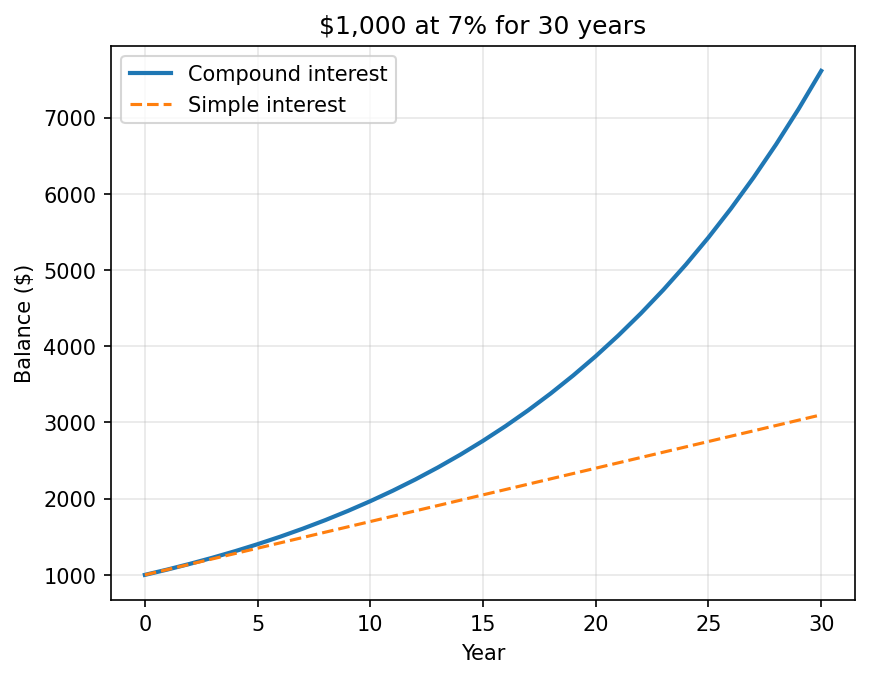

# 01 · Compound interest calculator

Shows how money grows year by year at a fixed interest rate, and how much more you get from compound interest than from simple interest.



## Example

$1,000 at 7% for 30 years:

```
After 30 years: $7,612.26 with compound interest
vs $3,100.00 with simple interest
Compounding earned you an extra $4,512.26
```

## How it works

Each year the balance is multiplied by `1 + rate`, so interest is earned on past interest too:

```
balance after n years = principal × (1 + rate)^n
```

Simple interest only pays on the original amount: `principal × (1 + rate × n)`.

## Run it

```bash
pip install -r requirements.txt
python compound_interest.py
```

It asks for the starting amount, rate and number of years, prints a table and saves `growth.png`.

## What I learned

- Compounding is exponential, so the gap with simple interest is small at first and huge later.
- Building a list in a loop where each value depends on the previous one.
