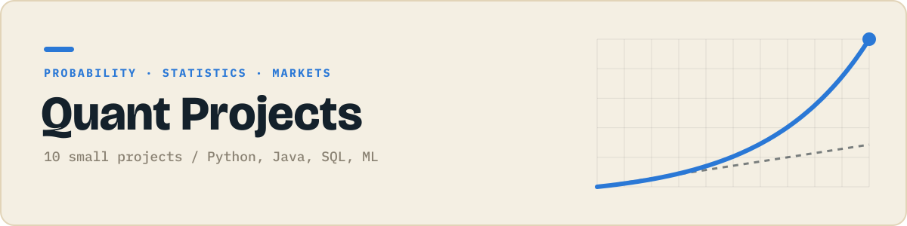

<p align="center"></p>

<p align="center">
  
  
</p>

Probability, statistics and markets, built up one small idea at a time.

Each folder is one small, self contained project that does one thing. They get harder as the numbers go up: first scripts, then data and charts, then Java, SQL and APIs, then a first machine learning model.

## Projects

| # | Project | What it does | Language | Status |
|:-:|---|---|:-:|:-:|
| 01 | **[Compound interest calculator](./01-compound-interest)** | Shows how money grows year by year at a fixed rate. |  | ✅ |
| 02 | Coin flip streaks simulator | Flips a coin thousands of times and finds the longest streak. |  | 🔜 |
| 03 | Dice rolls: simulated vs theoretical odds | Compares simulated dice sums with the exact probabilities. |  | ⬜ |
| 04 | Mean, median, std from scratch | Computes basic statistics with no libraries. |  | ⬜ |
| 05 | Daily returns of one stock | Turns a price CSV into daily percentage returns. |  | ⬜ |
| 06 | Random walk stock plot | Simulates a fake stock price as a random walk. |  | ⬜ |
| 07 | Matrix calculator | Adds, multiplies and transposes matrices. |  | ⬜ |
| 08 | Moving average crossover signals | Marks buy and sell signals where two moving averages cross. |  | ⬜ |
| 09 | Stock prices in SQLite | Stores prices in a database and queries the best and worst days. |  | ⬜ |
| 10 | Linear regression: a stock's beta | Estimates how much a stock moves with the S&P 500. |  | ⬜ |

✅ done &nbsp; 🔜 up next &nbsp; ⬜ planned

## Running a project

```bash
git clone https://github.com/JilkaTeerth/quant-projects.git
cd quant-projects/01-...
```

Every folder has its own README with the exact commands. Python projects need `pip install -r requirements.txt`, Java projects compile with plain `javac`.

---

<sub>Part of a series of six project collections. See them all at [github.com/JilkaTeerth](https://github.com/JilkaTeerth).</sub>
